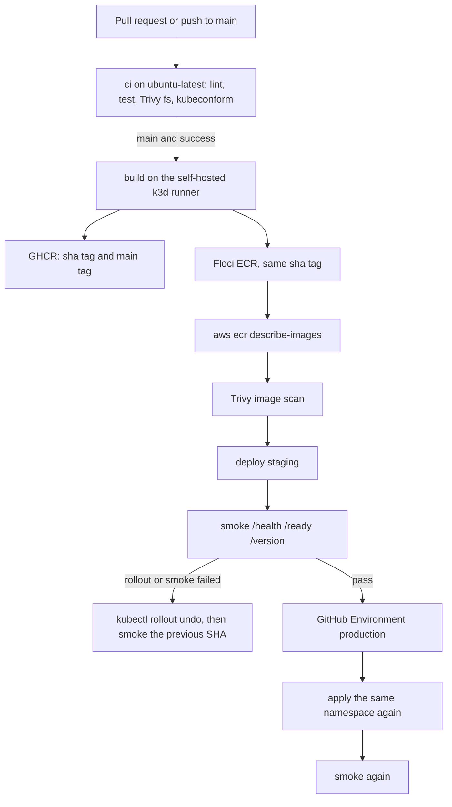

# Zero-downtime deployment pipeline

Lint, test, Trivy, GHCR, a rolling deploy, smoke checks, and rollback for one NestJS API on Kubernetes.

Architecture, the file map, and interview questions are in [docs/TECHNICAL.md](docs/TECHNICAL.md). The decisions are in [docs/adr](docs/adr).

## Pipeline

Pull requests never touch the cluster. A green `ci` workflow on `main` is what starts `deploy`.



Staging and production are the same namespace, `zdp`, on one k3d cluster. The production job is the approval gate plus a second smoke. There is no second cluster.

## Run it

You need Docker, Node 22, k3d, kubectl, kustomize, the AWS CLI, and about 2 GB of memory for the cluster. Give the node spare CPU and memory: `maxSurge: 1` starts a fourth API pod during the rollout, and the rollout stalls if that pod cannot be scheduled.

Phase A, on the laptop, no cluster:

```bash
make test
make up
curl -sS localhost:3000/health
curl -sS localhost:3000/ready
curl -sS localhost:3000/version
```

Stop Postgres and the process stays up. `/health` stays 200. `/ready` becomes 503.

```bash
docker stop zero-pipeline-postgres-1
curl -sS -w '\n%{http_code}\n' localhost:3000/health
curl -sS -w '\n%{http_code}\n' localhost:3000/ready
```

Phase B, k3d:

```bash
cp .env.example .env
make image
make floci
make cluster
make deploy
make smoke
```

`make deploy` imports the image into k3d, sets the tag to `sha-<git sha>`, applies `k8s/`, and waits for the rollout. Smoke calls `http://127.0.0.1:8080`. The Service is a LoadBalancer on port 80. k3d publishes that as host port 8080. There is no Ingress.

GitHub, after you push `github.com/AbdelazizHachemi/zero-downtime-pipeline`:

1. Register a self-hosted runner on this machine with the label `k3d`. Deploy jobs use it because a GitHub-hosted runner cannot see k3d or Floci.
2. Create environment `staging` with no required reviewer.
3. Create environment `production` with a required reviewer. A second GitHub account is the click. The pattern at a company is a person on the team, not a timer.
4. After the first push to GHCR, make the package public so a recruiter can open the image without your laptop.
5. `ci` runs on pull requests and on pushes to `main`. `deploy` runs when that `ci` run on `main` succeeds, or when you dispatch it with `action=deploy` or `action=rollback`.

The in-cluster identity a company would use is a short-lived OIDC token scoped to one namespace. This repo uses the kubeconfig already on the self-hosted runner, because the cluster is local k3d and a long-lived cloud credential is the wrong lesson.

## Probes

| Probe | Path | What it proves |
| --- | --- | --- |
| startup | `GET /health` | The process is up. Liveness does not run yet, so a slow boot is not killed. Period 5s, 12 failures. |
| readiness | `GET /ready` | `SELECT 1` against Postgres, 1s timeout. 200 joins the Service. 503 leaves the pod running and takes it out of rotation. |
| liveness | `GET /health` | The process is up. It does not touch Postgres. |

`GET /health` returns `{"status":"ok"}`. `GET /ready` returns `{"status":"ready"}` or `{"status":"not_ready"}` with 503. `GET /version` returns `{"sha":"<git sha>","builtAt":"<ISO-8601>"}`. `sha` and `builtAt` are `GIT_SHA` and `BUILT_AT` from `docker build`. They are not read from a ConfigMap.

`READY_FAIL=true` makes `/ready` return 503 before it touches the database. That is the failure demo. It is off unless the Deployment sets it.

## Measured on this machine

29 September 2026, one k3d server, Docker with the containerd snapshotter.

| Check | Result |
| --- | --- |
| `npm test` | 4 tests passed |
| Trivy fs, HIGH and CRITICAL | clean |
| Trivy image, HIGH and CRITICAL | clean after the runtime image drops npm and upgrades Alpine packages |
| Image size, `docker image ls` | 269 MB |
| Base `node:22-alpine` | pinned `sha256:16e22a550f3863206a3f701448c45f7912c6896a62de43add43bb9c86130c3e2`, about 230 MB |
| Second SHA rollout | 466 requests to `/version`, 10 per second, all HTTP 200. First body was `sha-1111…1111`. Last body was `sha-2222…2222`. |
| Laptop `make deploy` of that second SHA | about 60 seconds, including image import |

The 150 MB budget is below the pinned base image, so the API image cannot reach it without a different base. The runtime stage is still `node:22-alpine`, as required. It copies `dist` and production `node_modules`, runs as the `node` user, and deletes the unused npm and yarn trees so the image scan is not failing on the base image's bundled npm.

A GitHub Actions wall-clock time is not in this file yet. The spec asks for a real Actions run, and this repo has not been pushed. After the first green `deploy` run, replace this sentence with that run's duration. If it is over five minutes, fix caching before adding anything else. The build job already uses `cache-from` and `cache-to` `type=gha`.

## Failure demo

Local, 29 September 2026, after the SHA above was serving:

1. `kubectl -n zdp set env deploy/api READY_FAIL=true`
2. `kubectl -n zdp rollout status deploy/api --timeout=45s` exited 1. The new pod stayed `0/1`. Three old pods stayed `1/1`.
3. During that wait, `GET /version` still returned `sha-2222…2222` and `GET /ready` was 200. `maxUnavailable: 0` kept the old pods in the Service.
4. `scripts/rollback.sh` rolled back. Smoke then returned the same previous SHA. The Deployment env was empty again.

The three screenshots the spec asks for are from GitHub Actions, and they are not in this repo until that run exists. Capture them from a branch that sets `READY_FAIL=true` on the API container and nothing else, merge it so `deploy.yml` runs, then revert that commit. Do not leave it on `main`.

1. The Actions graph: deploy, failed smoke or failed rollout, rollback.
2. `kubectl -n zdp rollout history deploy/api`
3. `curl` of `/version` showing the previous SHA.

Put the three images next to this list after that run.

## Why rolling

This is one small API with no schema change. Rolling needs half the pods of blue/green, one Service, and `kubectl rollout undo`. It only works because `/ready` gates the Service and `maxUnavailable` is 0. The argument is [ADR 0001](docs/adr/0001-rolling-not-blue-green.md).

## Identity

A company would use a team as the production reviewer, plus OIDC from GitHub to the cluster, instead of a kubeconfig sitting on a runner. This repo uses the runner kubeconfig because the cluster is local k3d and a long-lived cloud credential is the wrong lesson. See [ADR 0003](docs/adr/0003-github-environments.md).

## Floci

`make floci` pulls `floci/floci:latest` and listens on port 4566. Tested image: Floci 2.1.0, digest `sha256:f5aa8c18302cedb4f2385f5c4e455b3efc77fee6bf7b6e5d1712b2817ba102db`. An older local image, 1.7.0, accepted `docker push` and then returned an empty `describe-images`. Pull before you trust the gate.

Any non-empty credentials work. Do not put a real AWS key here.

```bash
export AWS_ENDPOINT_URL=http://127.0.0.1:4566
export AWS_DEFAULT_REGION=us-east-1
export AWS_ACCESS_KEY_ID=test
export AWS_SECRET_ACCESS_KEY=test
aws ecr describe-images \
  --repository-name zero-downtime-pipeline \
  --image-ids imageTag=sha-<full git sha> \
  --endpoint-url "$AWS_ENDPOINT_URL"
```

`CreateRepository` on Floci 2.1 returns `000000000000.dkr.ecr.us-east-1.localhost:4566/zero-downtime-pipeline`. That URI is the image the Deployment runs. k3d cannot pull it: inside a node, that hostname is the node, not the laptop where Floci listens. `make deploy` imports the tag into cluster `zdp` after the push. A company cluster would pull ECR with an IAM role.

GHCR gets the same SHA tag, plus a moving `:main` tag that the Deployment never uses. `:latest` is not pushed.

MIT license. Copyright 2026 HACHEMI Abdelaziz.
